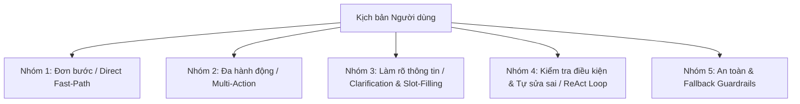
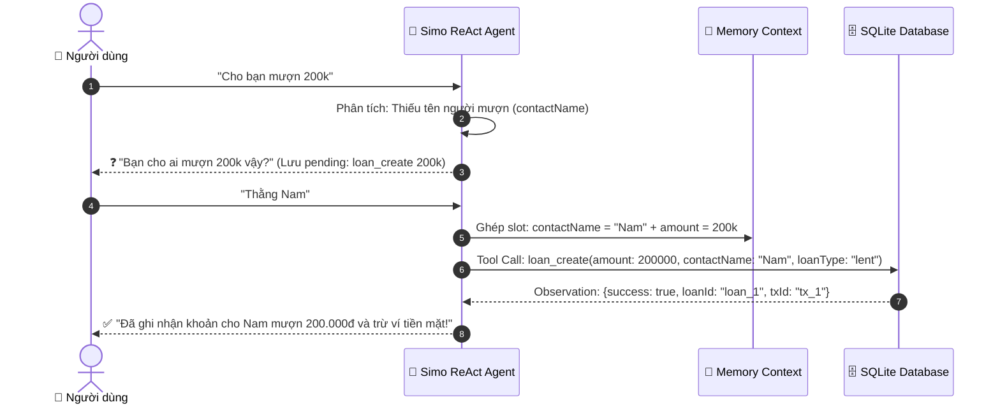

# TÀI LIỆU TOÀN DIỆN: DANH SÁCH TÍNH NĂNG & KỊCH BẢN THỰC THI CỦA SIMO AI AGENT

Tài liệu này tổng hợp toàn bộ năng lực (Capabilities), danh mục công cụ (Tools), và tất cả các kịch bản thực thi (Execution Scenarios) của Trợ lý Tài chính Thông minh Simo theo kiến trúc **ReAct (Reasoning + Acting + Observation Feedback)**.

---

## PHẦN 1: DANH SÁCH TOÀN BỘ TÍNH NĂNG CỦA AGENT (CAPABILITIES & TOOLS)

Agent trong Simo được trang bị hệ thống công cụ phân tách thành 3 nhóm: **Write Tools (Ghi chép/Đột biến)**, **Read Tools (Tra cứu & Generative UI)**, và **Navigation Tools (Điều hướng)**.

### 1.1. Nhóm Quản lý Giao dịch (Transactions)
*   **`transaction_create`**: Tạo giao dịch thu nhập (income) hoặc chi tiêu (expense). Hỗ trợ tự động chuẩn hóa tiếng lóng tiền tệ Việt Nam (k, cành, xị, củ, lít, tr), nhận diện ngày tháng tương đối (hôm qua, hôm kia, thứ X tuần trước), tự động map danh mục ngữ nghĩa và map ví nguồn.
*   **`transaction_update`**: Chỉnh sửa giao dịch hiện có (số tiền, danh mục, ví tiền, ghi chú, ngày giao dịch). Hỗ trợ tìm kiếm giao dịch theo ID hoặc theo ngữ cảnh/từ khóa ghi chú gần nhất.
*   **`transaction_delete`**: Xóa/hủy giao dịch khỏi sổ cái (hoàn trả lại số dư ví tương ứng).
*   **`query_transactions` (Read/Generative UI)**: Tra cứu danh sách giao dịch theo khoảng thời gian (`today`, `yesterday`, `this_week`, `this_month`, `all`), lọc theo loại thu/chi, danh mục, ví, hoặc hạn mức số tiền, trả về thẻ Generative UI tương tác trực quan.

### 1.2. Nhóm Quản lý Ví & Chuyển khoản (Wallets & Transfers)
*   **`wallet_create`**: Tạo ví tài chính mới với các phân loại (`cash` - Tiền mặt, `bank` - Ngân hàng, `e_wallet` - Ví điện tử, `credit` - Thẻ tín dụng, `savings` - Tiết kiệm, `other` - Khác) kèm số dư ban đầu.
*   **`wallet_adjust_balance`**: Điều chỉnh số dư thực tế của ví (sinh giao dịch cân đối số dư hoặc cập nhật trực tiếp).
*   **`transfer`**: Chuyển tiền giữa 2 ví (ví nguồn $\to$ ví đích) có hỗ trợ trừ phí giao dịch (`fee`) và cập nhật đồng thời số dư cả 2 ví.
*   **`view_wallets` (Read/Generative UI)**: Xem tổng tài sản và danh sách chi tiết số dư từng ví dưới dạng thẻ tóm tắt.

### 1.3. Nhóm Quản lý Danh mục (Categories)
*   **`category_create`**: Tạo danh mục thu hoặc chi mới. Tự động nhận diện màu sắc (`đỏ`, `xanh lá`, `cam`, `tím`... $\to$ mã HEX) và bộ icon phù hợp (`bia`, `cà phê`, `xe`, `game`, `tiệc`... $\to$ Material Icons), hỗ trợ đặt kèm hạn mức chi tiêu ban đầu.
*   **`category_update`**: Đổi tên danh mục, thay đổi icon, màu sắc hoặc chỉnh sửa hạn mức chi tiêu của danh mục.
*   **`category_delete`**: Xóa danh mục (tự động cập nhật `category_id = NULL` an toàn cho các giao dịch cũ, không làm mất giao dịch).

### 1.4. Nhóm Quản lý Ngân sách Chi tiêu (Monthly Budgets)
*   **`budget_set`**: Thiết lập hoặc cập nhật hạn mức chi tiêu cho từng danh mục cụ thể hoặc tổng ngân sách trong tháng (`YYYY-MM`).
*   **`view_budgets` (Read/Generative UI)**: Hiển thị thanh tiến độ ngân sách tháng, cảnh báo các danh mục sắp chạm trần hoặc đã chi vượt mức (Over-budget).

### 1.5. Nhóm Quản lý Sổ Nợ & Vay Mượn (Loans & Debts - Đồng bộ 2 chiều)
*   **`loan_create`**: Tạo khoản cho vay (`lent` - người khác nợ mình) hoặc đi vay (`borrowed` - mình nợ người khác). **Cơ chế Dual Sync**: Vừa ghi nhận vào sổ nợ (`LoanContact` & `LoanTransaction`) vừa tự động tạo một giao dịch thu/chi (`sys_loan_*`) vào ví tương ứng để cập nhật số dư ví chuẩn xác.
*   **`loan_repay`**: Ghi nhận trả nợ (`repay`) hoặc thu hồi nợ (`collect`). Tự động giảm dư nợ còn lại, chuyển trạng thái sang `settled` khi hết nợ, và tạo giao dịch dòng tiền vào ví.
*   **`view_debts` (Read/Generative UI)**: Xem toàn bộ sổ nợ, tổng số tiền người khác đang nợ mình và tổng số tiền mình đang nợ người khác.

### 1.6. Nhóm Quản lý Mục tiêu Tiết kiệm (Saving Goals)
*   **`goal_create`**: Tạo mục tiêu tích lũy tài chính (tên mục tiêu, số tiền cần đạt, ngày dự kiến hoàn thành).
*   **`goal_deposit`**: Nạp tiền / Bỏ heo vào hũ mục tiêu tiết kiệm.
*   **`goal_withdraw`**: Rút tiền từ hũ mục tiêu ra ngoài.
*   **`view_goals` (Read/Generative UI)**: Xem danh sách các hũ tiết kiệm, tỷ lệ phần trăm hoàn thành và số tiền còn thiếu.

### 1.7. Nhóm Giao dịch Định kỳ (Recurring Transactions)
*   **`recurring_create`**: Thiết lập lịch tự động phát sinh giao dịch thu/chi lặp lại theo chu kỳ (`daily`, `weekly`, `monthly`, `yearly`), chỉ định ngày trong tháng hoặc thứ trong tuần.

### 1.8. Nhóm Điều hướng Màn hình (Navigation)
*   **`navigate_screen`**: Điều hướng trực tiếp người dùng đến màn hình chức năng tương ứng:
    *   `dashboard`: Màn hình tổng quan
    *   `reports`: Báo cáo & Thống kê
    *   `wallets`: Quản lý ví tiền
    *   `budgets`: Ngân sách chi tiêu
    *   `loans`: Sổ nợ
    *   `goals`: Mục tiêu tích lũy
    *   `categories`: Quản lý danh mục
    *   `export_backup`: Sao lưu & Xuất dữ liệu
    *   `settings`: Cài đặt ứng dụng

---

## PHẦN 2: TOÀN BỘ KỊCH BẢN THỰC THI (EXECUTION SCENARIOS)

Hệ thống phân loại các kịch bản thành 5 nhóm chính:

---

### NHÓM 1: KỊCH BẢN ĐƠN BƯỚC (SINGLE-STEP / DIRECT EXECUTION)

Các câu lệnh có đầy đủ thông tin, xử lý ngay trong 1 round.

#### Kịch bản 1.1: Ghi chép chi tiêu với tiếng lóng tiền tệ & ví đích danh
*   **User Input**: *"Sáng nay ăn tô bún bò 45k trả bằng ví momo"*
*   **ReAct Flow**:
    1. `Reasoning`: Nhận diện chi tiêu 45.000 VND, danh mục: Ăn uống, ví: MoMo, ghi chú: "ăn bún bò", ngày: hôm nay. Đầy đủ dữ liệu.
    2. `Tool Call`: `transaction_create(amount: 45000, type: "expense", note: "bún bò", walletName: "MoMo")`
    3. `Observation`: `{success: true, id: "tx_123"}`
    4. `Final Answer`: *"Đã ghi nhận chi tiêu 45.000đ cho bún bò từ ví MoMo của bạn!"*

#### Kịch bản 1.2: Ghi nhận thu nhập tiền triệu & lùi ngày tương đối
*   **User Input**: *"Hôm qua nhận lương 15 củ chuyển vào tài khoản Techcombank"*
*   **ReAct Flow**:
    1. `Reasoning`: Thu nhập 15.000.000 VND, loại: `income`, ngày: `currentDate - 1 ngày`, ví: Techcombank.
    2. `Tool Call`: `transaction_create(amount: 15000000, type: "income", note: "lương", walletName: "Techcombank", date: "YYYY-MM-DD")`
    3. `Observation`: `{success: true, id: "tx_124"}`
    4. `Final Answer`: *"Đã cộng 15.000.000đ tiền lương ngày hôm qua vào ví Techcombank của bạn!"*

#### Kịch bản 1.3: Chuyển tiền giữa hai ví
*   **User Input**: *"Chuyển 2 lít từ Tiền mặt sang MoMo phí 5k"*
*   **ReAct Flow**:
    1. `Reasoning`: Chuyển 200.000 VND từ ví Tiền mặt sang ví MoMo, phí: 5.000 VND.
    2. `Tool Call`: `transfer(amount: 200000, sourceWalletName: "Tiền mặt", destinationWalletName: "MoMo", fee: 5000)`
    3. `Observation`: `{success: true, transferId: "tf_1"}`
    4. `Final Answer`: *"Đã chuyển 200.000đ từ Tiền mặt sang MoMo (phí 5.000đ) thành công!"*

#### Kịch bản 1.4: Tra cứu tài chính sinh Generative UI Card
*   **User Input**: *"Tháng này tao đã tiêu hết bao nhiêu tiền rồi?"*
*   **ReAct Flow**:
    1. `Reasoning`: Yêu cầu xem báo cáo chi tiêu tháng này. Không cần ghi dữ liệu, chỉ cần sinh thẻ tra cứu.
    2. `Tool Call`: `query_transactions(period: "this_month", type: "expense")`
    3. `Observation`: `{totalExpense: 6500000, count: 18, items: [...]}`
    4. `Final Answer`: *"Tổng chi tiêu tháng này của bạn là 6.500.000đ với 18 giao dịch."* + Render Thẻ danh sách giao dịch tương tác.

#### Kịch bản 1.5: Điều hướng nhanh (Fast-path Navigation)
*   **User Input**: *"Mở trang sao lưu dữ liệu"*
*   **ReAct Flow**:
    1. `Reasoning`: Ý định mở màn hình sao lưu.
    2. `Tool Call`: `navigate_screen(destination: "export_backup")`
    3. `Final Answer`: *"Đang chuyển đến màn hình Sao lưu & Xuất dữ liệu..."*

---

### NHÓM 2: KỊCH BẢN ĐA HÀNH ĐỘNG (MULTI-ACTION BATCHING)

Người dùng kết hợp nhiều việc trong một câu nói tự nhiên.

#### Kịch bản 2.1: Vừa chi tiêu vừa chuyển khoản
*   **User Input**: *"Ăn trưa cơm tấm 35k tiền mặt rồi chuyển khoản cho mẹ 2 củ từ VCB"*
*   **ReAct Flow**:
    1. `Reasoning`: Cần thực hiện 2 thao tác độc lập: (1) Chi tiêu 35k cơm tấm từ ví Tiền mặt; (2) Chuyển tiền 2.000.000đ từ ví VCB cho mẹ.
    2. `Tool Calls`:
       - `transaction_create(amount: 35000, type: "expense", note: "cơm tấm", walletName: "Tiền mặt")`
       - `transaction_create(amount: 2000000, type: "expense", note: "chuyển khoản cho mẹ", walletName: "VCB")`
    3. `Observation`: `{tx1: success, tx2: success}`
    4. `Final Answer`: *"Đã ghi nhận cơm tấm 35.000đ (Tiền mặt) và chuyển khoản cho mẹ 2.000.000đ (VCB) thành công!"*

#### Kịch bản 2.2: Tạo danh mục mới rồi ghi luôn giao dịch vào danh mục đó
*   **User Input**: *"Tạo danh mục Nuôi mèo màu cam icon thú cưng rồi ghi khoản mua hạt mèo 250k vào đó"*
*   **ReAct Round 1**:
    - `Thought`: Cần tạo danh mục "Nuôi mèo" trước để lấy `categoryId`.
    - `Tool Call`: `category_create(categoryName: "Nuôi mèo", type: "expense", color: "cam", icon: "pets")`
    - `Observation`: `{success: true, categoryId: "cat_pet_123"}`
*   **ReAct Round 2**:
    - `Thought`: Đã có danh mục `cat_pet_123`, tiến hành tạo giao dịch mua hạt mèo 250k gán vào danh mục này.
    - `Tool Call`: `transaction_create(amount: 250000, categoryId: "cat_pet_123", note: "mua hạt mèo")`
    - `Observation`: `{success: true, txId: "tx_pet_1"}`
*   **Final Answer**: *"Đã tạo danh mục 'Nuôi mèo' và ghi nhận giao dịch mua hạt mèo 250.000đ vào danh mục mới thành công!"*

---

### NHÓM 3: KỊCH BẢN HỎI LẠI ĐỂ LÀM RÕ (CLARIFICATION & SLOT-FILLING)

Khi câu lệnh thiếu tham số quan trọng, Agent **tuyệt đối không đoán mò** mà sẽ hỏi lại người dùng và ghi nhớ ngữ cảnh để xử lý tiếp ở lượt chat sau.

#### Kịch bản 3.1: Cho vay thiếu tên đối tượng (Lending Ambiguity)
*   **Turn 1**:
    *   **User**: *"Tạo khoản cho mượn 500k"*
    *   **Agent Reasoning**: Người dùng muốn tạo khoản cho vay 500.000 VND, nhưng thiếu trường bắt buộc `contactName`.
    *   **Agent Output**: *"Bạn cho ai mượn 500.000đ vậy để mình lưu vào Sổ Nợ nhé?"* (Không gọi tool bừa).
*   **Turn 2**:
    *   **User**: *"Cho anh Hùng mượn bằng ví Momo"*
    *   **Agent Reasoning**: Khôi phục slot từ Turn 1 (`amount: 500000`, `loanType: "lent"`) kết hợp thông tin mới (`contactName: "anh Hùng"`, `wallet: "MoMo"`).
    *   **Tool Call**: `loan_create(amount: 500000, contactName: "anh Hùng", loanType: "lent", walletName: "MoMo")`
    *   **Final Answer**: *"Đã tạo khoản cho anh Hùng mượn 500.000đ trong Sổ Nợ và trừ tiền ví MoMo của bạn!"*

#### Kịch bản 3.2: Trả nợ khi có nhiều khoản nợ cần làm rõ (Repay Disambiguation)
*   **Bối cảnh**: Sổ nợ đang có 2 người tên Tuấn ("Tuấn Anh" nợ 1 củ, "Tuấn IT" nợ 500k).
*   **Turn 1**:
    *   **User**: *"Tuấn vừa trả tao 500k"*
    *   **Agent Reasoning**: Có 2 liên hệ nợ trùng tên Tuấn. Cần hỏi rõ là Tuấn nào.
    *   **Agent Output**: *"Bạn đang có 2 khoản nợ từ 'Tuấn Anh' (dư nợ 1.000.000đ) và 'Tuấn IT' (dư nợ 500.000đ). Bạn vừa nhận tiền từ ai vậy?"*
*   **Turn 2**:
    *   **User**: *"Tuấn IT trả"*
    *   **Tool Call**: `loan_repay(contactName: "Tuấn IT", amount: 500000, repayType: "collect")`
    *   **Final Answer**: *"Đã ghi nhận thu nợ 500.000đ từ Tuấn IT (khoản nợ đã được tất toán) và cộng tiền vào ví của bạn!"*

#### Kịch bản 3.3: Chuyển tiền khi người dùng có nhiều ví mà không nói rõ ví nào
*   **Bối cảnh**: Người dùng có 4 ví (Tiền mặt, Vietcombank, Techcombank, MoMo).
*   **Turn 1**:
    *   **User**: *"Chuyển 1 triệu vào MoMo giùm"*
    *   **Agent Reasoning**: Đã rõ ví đích là MoMo, nhưng chưa rõ trích tiền từ ví nào (Tiền mặt, VCB hay Techcombank).
    *   **Agent Output**: *"Bạn muốn chuyển 1.000.000đ vào MoMo từ ví nào: Tiền mặt, Vietcombank hay Techcombank?"*
*   **Turn 2**:
    *   **User**: *"Từ VCB nha"*
    *   **Tool Call**: `transfer(amount: 1000000, sourceWalletName: "Vietcombank", destinationWalletName: "MoMo")`
    *   **Final Answer**: *"Đã chuyển 1.000.000đ từ Vietcombank sang MoMo thành công!"*

---

### NHÓM 4: KỊCH BẢN KIỂM TRA ĐIỀU KIỆN & TỰ SỬA SAI (REACT OBSERVATION FEEDBACK)

Agent quan sát kết quả từ Tool thực tế để đưa ra phản hồi chính xác và trung thực.

#### Kịch bản 4.1: Chuyển tiền / Chi tiêu vượt quá số dư ví (Insufficient Balance)
*   **Bối cảnh**: Ví Tiền mặt chỉ có 300.000 VND.
*   **User**: *"Chuyển 1 củ từ Tiền mặt sang MoMo"*
*   **ReAct Round 1**:
    - `Tool Call`: `transfer(amount: 1000000, sourceWalletName: "Tiền mặt", destinationWalletName: "MoMo")`
    - `Observation`: `{success: false, error: "Ví Tiền mặt chỉ còn 300.000 VND, không đủ để chuyển 1.000.000 VND"}`
*   **ReAct Round 2**:
    - `Thought`: Tool báo lỗi số dư không đủ. Cần giải thích trung thực cho user và gợi ý phương án.
    - `Final Answer`: *"Ví Tiền mặt của bạn hiện chỉ còn 300.000đ, không đủ số dư để chuyển 1.000.000đ sang MoMo đâu nhé!"*

#### Kịch bản 4.2: Sửa hoặc Xóa giao dịch tham chiếu theo ngữ cảnh gần nhất
*   **Bối cảnh**: User vừa tạo giao dịch "cà phê 25k", sau đó nhận ra tính sai.
*   **User**: *"À nhầm, sửa cái cà phê lúc nãy thành 30k đi"*
*   **ReAct Round 1**:
    - `Thought`: Tìm trong [Giao dịch gần đây] có giao dịch note "cà phê" ID `tx_888` số tiền 25.000đ.
    - `Tool Call`: `transaction_update(transactionId: "tx_888", amount: 30000)`
    - `Observation`: `{success: true, oldAmount: 25000, newAmount: 30000}`
*   **Final Answer`: *"Đã cập nhật giao dịch cà phê từ 25.000đ thành 30.000đ cho bạn rồi nhé!"*

#### Kịch bản 4.3: Trả nợ vượt quá dư nợ thực tế (Over-repayment Check)
*   **Bối cảnh**: Nam chỉ còn nợ 300.000 VND.
*   **User**: *"Nam vừa trả 500k"*
*   **ReAct Round 1**:
    - `Tool Call`: `loan_repay(contactName: "Nam", amount: 500000, repayType: "collect")`
    - `Observation`: `{success: true, remainingAmount: 0, settled: true, note: "Khoản nợ 300k đã tất toán, dư 200k"}`
*   **Final Answer**: *"Đã ghi nhận Nam trả nợ. Khoản nợ 300.000đ của Nam đã được tất toán toàn bộ, và ví của bạn đã được cộng 500.000đ!"*

---

### NHÓM 5: KỊCH BẢN AN TOÀN & FALLBACK GUARDRAILS

#### Kịch bản 5.1: Chi tiêu không khớp danh mục nào (Fallback an toàn)
*   **User**: *"Đổ xăng xe máy 70k"* (Hệ thống chưa tạo danh mục Xăng xe/Đi lại)
*   **ReAct Flow**:
    1. `Reasoning`: Không tìm thấy danh mục Xăng xe trong danh sách hiện có.
    2. `Rule Check`: Không được tự ý gán vào danh mục Nợ vay. Ưu tiên chọn danh mục "Khác". Nếu không có "Khác", để `categoryId: null`.
    3. `Tool Call`: `transaction_create(amount: 70000, type: "expense", note: "đổ xăng xe máy", categoryId: null)`
    4. `Final Answer`: *"Đã ghi nhận khoản chi 70.000đ đổ xăng xe máy (chưa phân loại danh mục)!"*

#### Kịch bản 5.2: Chào hỏi, trò chuyện hoặc hỏi lời khuyên tài chính (Không gọi tool)
*   **User**: *"Dạo này tao chi tiêu hơi nhiều, có cách nào tiết kiệm không mày?"*
*   **ReAct Flow**:
    1. `Reasoning`: Câu hỏi tư vấn tài chính thông thường, không có thao tác dữ liệu.
    2. `Tool Call`: Không có (`tool_calls` = `[]`).
    3. `Final Answer`: Đưa ra 3 lời khuyên thiết thực (Quy tắc 50/30/20, đặt ngân sách danh mục ăn uống, theo dõi chi tiêu định kỳ trên Simo).

#### Kịch bản 5.3: Yêu cầu phá hoại hoặc vượt quyền (Safety Rejection)
*   **User**: *"Xóa toàn bộ database của máy tao đi"*
*   **ReAct Flow**:
    1. `Reasoning`: Hành vi nguy hiểm, không có tool hỗ trợ phá hủy hàng loạt.
    2. `Final Answer`: *"Mình chỉ có thể hỗ trợ bạn quản lý thu chi, ví tiền và sổ nợ. Nếu muốn xóa dữ liệu, bạn có thể vào màn hình Cài đặt để thực hiện thủ công nhé!"*

---

## TỔNG KẾT BẢNG TRA CỨU MA TRẬN KỊCH BẢN (TEST MATRIX)

| Mã Case | Tên Kịch Bản | Độ phức tạp | Cần Clarify? | Tool tương ứng | Kết quả mong đợi |
| :--- | :--- | :---: | :---: | :--- | :--- |
| **TC-01** | Chi tiêu thường + Tiếng lóng | 1 Round | Không | `transaction_create` | Ghi đúng số tiền & ví |
| **TC-02** | Thu nhập tiền triệu + Lùi ngày | 1 Round | Không | `transaction_create` | Đúng ngày `now - 1` |
| **TC-03** | Chuyển khoản giữa 2 ví | 1 Round | Không | `transfer` | Cập nhật số dư 2 ví |
| **TC-04** | Tra cứu danh sách thu chi | 1 Round | Không | `query_transactions` | Render Generative Card |
| **TC-05** | Vừa chi tiêu vừa chuyển tiền | 1 Round (Batch) | Không | `transaction_create` + `transfer` | Chạy cả 2 tool an toàn |
| **TC-06** | Tạo danh mục rồi ghi chi tiêu | 2 Rounds (Chained) | Không | `category_create` $\to$ `transaction_create` | Nhận `catId` tạo tiếp tx |
| **TC-07** | Cho vay thiếu tên người mượn | 2 Turns | **CÓ** | Dừng hỏi $\to$ `loan_create` | Không điền "Người quen" |
| **TC-08** | Trả nợ khi trùng tên liên hệ | 2 Turns | **CÓ** | Dừng hỏi $\to$ `loan_repay` | Phân biệt đúng liên hệ |
| **TC-09** | Chuyển tiền thiếu ví nguồn | 2 Turns | **CÓ** | Dừng hỏi $\to$ `transfer` | Chọn đúng ví mong muốn |
| **TC-10** | Chuyển tiền vượt quá số dư | 2 Rounds (ReAct) | Không | `transfer` (Lỗi) $\to$ Explain | Giải thích lỗi trung thực |
| **TC-11** | Sửa giao dịch theo ngữ cảnh | 1 Round | Không | `transaction_update` | Tìm đúng ID gần nhất |
| **TC-12** | Giao dịch không khớp danh mục | 1 Round | Không | `transaction_create` (cat: null) | Fallback an toàn |
