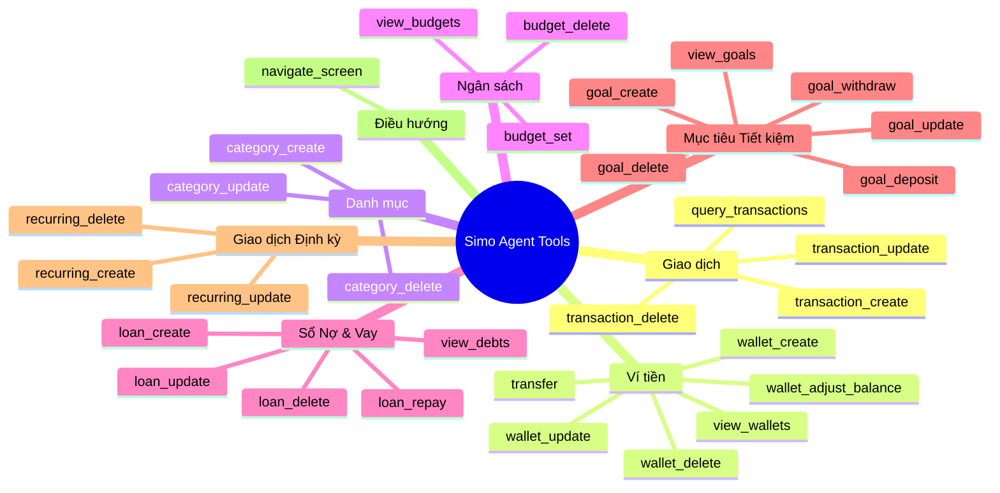
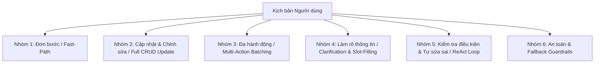
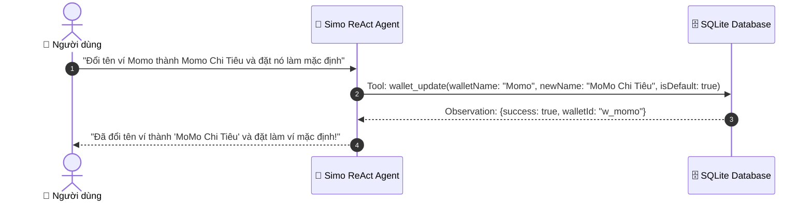
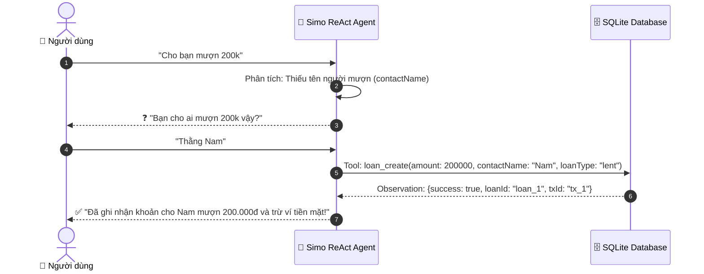

# TÀI LIỆU TOÀN DIỆN: DANH SÁCH TÍNH NĂNG & KỊCH BẢN THỰC THI CỦA SIMO AI AGENT

Tài liệu này tổng hợp toàn bộ năng lực (Capabilities), danh mục công cụ (Tools), và tất cả các kịch bản thực thi (Execution Scenarios) của Trợ lý Tài chính Thông minh Simo theo kiến trúc **ReAct (Reasoning + Acting + Observation Feedback)**.

---

## PHẦN 1: DANH SÁCH TOÀN BỘ TÍNH NĂNG CỦA AGENT (CAPABILITIES & TOOL INVENTORY)

Agent trong Simo được trang bị hệ thống công cụ chuẩn hóa theo mô hình CRUD toàn diện, phân tách thành 3 nhóm: **Write Tools (Ghi chép / Cập nhật / Xóa)**, **Read Tools (Tra cứu & Generative UI)**, và **Navigation Tools (Điều hướng)**.

---

### 1.1. Nhóm Quản lý Giao dịch (Transactions)
*   **`transaction_create`**: Tạo giao dịch thu nhập (income) hoặc chi tiêu (expense). Hỗ trợ chuẩn hóa tiếng lóng tiền tệ Việt Nam (k, cành, xị, củ, lít, tr), nhận diện ngày tháng tương đối (hôm qua, hôm kia, thứ X tuần trước), tự động map danh mục ngữ nghĩa và ví nguồn.
*   **`transaction_update`**: Cập nhật bất kỳ thuộc tính nào của giao dịch hiện có (số tiền, danh mục, ví thanh toán, ghi chú, ngày giao dịch). Hỗ trợ tìm giao dịch theo ID hoặc ngữ cảnh/từ khóa ghi chú gần nhất.
*   **`transaction_delete`**: Xóa/hủy giao dịch khỏi sổ cái (tự động hoàn trả lại số dư ví tương ứng).
*   **`query_transactions` (Read / Generative UI)**: Tra cứu danh sách giao dịch theo khoảng thời gian (`today`, `yesterday`, `this_week`, `this_month`, `all`), lọc theo loại thu/chi, danh mục, ví, hạn mức số tiền, trả về thẻ Generative UI tương tác trực quan.

---

### 1.2. Nhóm Quản lý Ví & Chuyển khoản (Wallets & Transfers)
*   **`wallet_create`**: Tạo ví tài chính mới (`cash` - Tiền mặt, `bank` - Ngân hàng, `e_wallet` - Ví điện tử, `credit` - Thẻ tín dụng, `savings` - Tiết kiệm, `other` - Khác) kèm số dư ban đầu.
*   **`wallet_update`**: Chỉnh sửa thông tin ví: Đổi tên ví, đổi loại ví, thay đổi icon, màu sắc hiển thị, hoặc thiết lập đặt làm ví mặc định (`isDefault`).
*   **`wallet_adjust_balance`**: Điều chỉnh số dư thực tế của ví (cân đối chênh lệch số dư).
*   **`wallet_delete`**: Xóa ví an toàn khi không còn nhu cầu sử dụng.
*   **`transfer`**: Chuyển tiền giữa 2 ví (ví nguồn $\to$ ví đích) có hỗ trợ trừ phí giao dịch (`fee`) và cập nhật đồng thời số dư cả 2 ví.
*   **`view_wallets` (Read / Generative UI)**: Xem tổng tài sản và danh sách chi tiết số dư từng ví dưới dạng thẻ tóm tắt.

---

### 1.3. Nhóm Quản lý Danh mục (Categories)
*   **`category_create`**: Tạo danh mục thu hoặc chi mới. Tự động nhận diện màu sắc (`đỏ`, `xanh lá`, `cam`, `tím`... $\to$ mã HEX) và bộ icon phù hợp (`bia`, `cà phê`, `xe`, `game`, `tiệc`... $\to$ Material Icons), hỗ trợ đặt kèm hạn mức chi tiêu ban đầu.
*   **`category_update`**: Đổi tên danh mục, thay đổi icon, màu sắc hoặc chỉnh sửa hạn mức chi tiêu của danh mục.
*   **`category_delete`**: Xóa danh mục (tự động cập nhật `category_id = NULL` an toàn cho các giao dịch cũ, không làm mất giao dịch).

---

### 1.4. Nhóm Quản lý Ngân sách Chi tiêu (Monthly Budgets)
*   **`budget_set`**: Thiết lập hoặc cập nhật tăng/giảm hạn mức chi tiêu cho từng danh mục cụ thể hoặc tổng ngân sách trong tháng (`YYYY-MM`).
*   **`budget_delete`**: Xóa bỏ hạn mức chi tiêu đã đặt của một danh mục hoặc toàn bộ tháng (reset về không giới hạn).
*   **`view_budgets` (Read / Generative UI)**: Hiển thị thanh tiến độ ngân sách tháng, cảnh báo các danh mục sắp chạm trần hoặc đã chi vượt mức (Over-budget).

---

### 1.5. Nhóm Quản lý Sổ Nợ & Vay Mượn (Loans & Debts - Dual Sync)
*   **`loan_create`**: Tạo khoản cho vay (`lent` - người khác nợ mình) hoặc đi vay (`borrowed` - mình nợ người khác). **Cơ chế Dual Sync**: Vừa ghi nhận vào sổ nợ (`LoanContact` & `LoanTransaction`) vừa tự động tạo một giao dịch thu/chi (`sys_loan_*`) vào ví tương ứng để cập nhật số dư ví chuẩn xác.
*   **`loan_update`**: Chỉnh sửa thông tin liên hệ nợ / khoản nợ: Đổi tên người nợ, sửa ngày hẹn trả (`dueDate`), cập nhật lại tổng số tiền nợ (khi có thỏa thuận lại hoặc tính sai), cập nhật ghi chú.
*   **`loan_delete`**: Xóa khoản nợ / liên hệ khỏi sổ nợ.
*   **`loan_repay`**: Ghi nhận trả nợ (`repay`) hoặc thu hồi nợ (`collect`). Tự động giảm dư nợ còn lại, chuyển trạng thái sang `settled` khi hết nợ, và tạo giao dịch dòng tiền vào ví.
*   **`view_debts` (Read / Generative UI)**: Xem toàn bộ sổ nợ, tổng số tiền người khác đang nợ mình và tổng số tiền mình đang nợ người khác.

---

### 1.6. Nhóm Quản lý Mục tiêu Tiết kiệm (Saving Goals)
*   **`goal_create`**: Tạo mục tiêu tích lũy tài chính (tên mục tiêu, số tiền cần đạt `targetAmount`, ngày dự kiến hoàn thành `targetDate`).
*   **`goal_update`**: Chỉnh sửa mục tiêu tiết kiệm: Đổi tên mục tiêu, tăng/giảm số tiền mục tiêu cần đạt, dời hạn chót hoàn thành (`targetDate`), đổi icon/màu sắc hoặc trạng thái (`active` / `completed`).
*   **`goal_delete`**: Xóa/hủy mục tiêu tiết kiệm.
*   **`goal_deposit`**: Nạp tiền / Bỏ heo vào hũ mục tiêu tiết kiệm.
*   **`goal_withdraw`**: Rút tiền từ hũ mục tiêu ra ngoài.
*   **`view_goals` (Read / Generative UI)**: Xem danh sách các hũ tiết kiệm, tỷ lệ phần trăm hoàn thành và số tiền còn thiếu.

---

### 1.7. Nhóm Giao dịch Định kỳ (Recurring Transactions)
*   **`recurring_create`**: Thiết lập lịch tự động phát sinh giao dịch thu/chi lặp lại theo chu kỳ (`daily`, `weekly`, `monthly`, `yearly`), chỉ định ngày trong tháng hoặc thứ trong tuần.
*   **`recurring_update`**: Chỉnh sửa cấu hình giao dịch định kỳ: Thay đổi số tiền, đổi ngày lặp trong tháng (`dayOfMonth`), đổi ví thanh toán hoặc danh mục gán vào, tạm dừng hoặc kích hoạt lại lịch lặp (`isActive`).
*   **`recurring_delete`**: Hủy/xóa bỏ hoàn toàn lịch phát sinh giao dịch định kỳ.

---

### 1.8. Nhóm Điều hướng Màn hình (Navigation)
*   **`navigate_screen`**: Điều hướng trực tiếp người dùng đến màn hình chức năng tương ứng (`dashboard`, `reports`, `wallets`, `budgets`, `loans`, `goals`, `categories`, `export_backup`, `settings`).

---

## PHẦN 2: TOÀN BỘ KỊCH BẢN THỰC THI (EXECUTION SCENARIOS)

Hệ thống phân loại các kịch bản thành 6 nhóm nghiệp vụ:

---

### NHÓM 1: KỊCH BẢN ĐƠN BƯỚC (SINGLE-STEP / DIRECT EXECUTION)

#### Kịch bản 1.1: Ghi chép chi tiêu với tiếng lóng tiền tệ & ví đích danh
*   **User Input**: *"Sáng nay ăn tô bún bò 45k trả bằng ví momo"*
*   **ReAct Flow**:
    1. `Reasoning`: Nhận diện chi tiêu 45.000 VND, danh mục: Ăn uống, ví: MoMo, ghi chú: "ăn bún bò", ngày: hôm nay.
    2. `Tool Call`: `transaction_create(amount: 45000, type: "expense", note: "bún bò", walletName: "MoMo")`
    3. `Observation`: `{success: true, id: "tx_123"}`
    4. `Final Answer`: *"Đã ghi nhận chi tiêu 45.000đ cho bún bò từ ví MoMo của bạn!"*

#### Kịch bản 1.2: Ghi nhận thu nhập tiền triệu & lùi ngày tương đối
*   **User Input**: *"Hôm qua nhận lương 15 củ chuyển vào tài khoản Techcombank"*
*   **ReAct Flow**:
    1. `Reasoning`: Thu nhập 15.000.000 VND, loại: `income`, ngày: `currentDate - 1 ngày`, ví: Techcombank.
    2. `Tool Call`: `transaction_create(amount: 15000000, type: "income", note: "lương", walletName: "Techcombank", date: "YYYY-MM-DD")`
    3. `Observation`: `{success: true, id: "tx_124"}`
    4. `Final Answer`: *"Đã cộng 15.000.000đ tiền lương ngày hôm qua vào ví Techcombank của bạn!"*

#### Kịch bản 1.3: Chuyển tiền giữa hai ví
*   **User Input**: *"Chuyển 2 lít từ Tiền mặt sang MoMo phí 5k"*
*   **ReAct Flow**:
    1. `Reasoning`: Chuyển 200.000 VND từ ví Tiền mặt sang ví MoMo, phí: 5.000 VND.
    2. `Tool Call`: `transfer(amount: 200000, sourceWalletName: "Tiền mặt", destinationWalletName: "MoMo", fee: 5000)`
    3. `Observation`: `{success: true, transferId: "tf_1"}`
    4. `Final Answer`: *"Đã chuyển 200.000đ từ Tiền mặt sang MoMo (phí 5.000đ) thành công!"*

#### Kịch bản 1.4: Tra cứu tài chính sinh Generative UI Card
*   **User Input**: *"Tháng này tao đã tiêu hết bao nhiêu tiền rồi?"*
*   **ReAct Flow**:
    1. `Reasoning`: Yêu cầu xem báo cáo chi tiêu tháng này. Trả về thẻ tra cứu trực quan.
    2. `Tool Call`: `query_transactions(period: "this_month", type: "expense")`
    3. `Observation`: `{totalExpense: 6500000, count: 18, items: [...]}`
    4. `Final Answer`: *"Tổng chi tiêu tháng này của bạn là 6.500.000đ với 18 giao dịch."* + Thẻ Transaction List Card.

#### Kịch bản 1.5: Điều hướng nhanh (Fast-path Navigation)
*   **User Input**: *"Mở trang sao lưu dữ liệu"*
*   **ReAct Flow**:
    1. `Reasoning`: Ý định mở màn hình sao lưu.
    2. `Tool Call`: `navigate_screen(destination: "export_backup")`
    3. `Final Answer`: *"Đang chuyển đến màn hình Sao lưu & Xuất dữ liệu..."*

---

### NHÓM 2: KỊCH BẢN CẬP NHẬT & CHỈNH SỬA TOÀN DIỆN (FULL CRUD & UPDATE SCENARIOS)

Nhóm này bao quát toàn bộ các thao tác chỉnh sửa thuộc tính của các thực thể trong Simo thông qua câu lệnh tự nhiên.

#### Kịch bản 2.1: Sửa thông tin Ví & Đặt ví mặc định (`wallet_update`)
*   **User Input**: *"Đổi tên ví Momo thành Momo Chi Tiêu và đặt nó làm ví mặc định giùm tao"*
*   **ReAct Flow**:
    1. `Reasoning`: Tìm ví có tên chứa "Momo", đổi tên mới thành "MoMo Chi Tiêu", đặt `isDefault = true`.
    2. `Tool Call`: `wallet_update(walletName: "Momo", newName: "MoMo Chi Tiêu", isDefault: true)`
    3. `Observation`: `{success: true, walletId: "wal_momo_1"}`
    4. `Final Answer`: *"Đã cập nhật tên ví thành 'MoMo Chi Tiêu' và đặt làm ví mặc định cho các giao dịch sau này!"*

#### Kịch bản 2.2: Sửa ngân sách chi tiêu tháng (`budget_set` / `budget_delete`)
*   **User Input**: *"Tăng ngân sách ăn uống tháng này từ 3 củ lên 4 củ rưỡi"*
*   **ReAct Flow**:
    1. `Reasoning`: Tìm danh mục "Ăn uống", cập nhật ngân sách tháng hiện tại thành 4.500.000 VND.
    2. `Tool Call`: `budget_set(categoryName: "Ăn uống", amount: 4500000)`
    3. `Observation`: `{success: true, category: "Ăn uống", newLimit: 4500000}`
    4. `Final Answer`: *"Đã nâng hạn mức chi tiêu danh mục Ăn uống tháng này lên 4.500.000đ!"*
*   *Case Xóa Ngân sách*: *"Xóa hạn mức chi tiêu của danh mục Mua sắm tháng này đi"* $\to$ `budget_delete(categoryName: "Mua sắm")` $\to$ Reset hạn mức về không giới hạn.

#### Kịch bản 2.3: Sửa thông tin khoản nợ & Dời ngày hẹn trả (`loan_update`)
*   **User Input**: *"Sửa khoản nợ của thằng Nam: dời ngày hẹn trả sang 30/10 và sửa lại nó chỉ nợ 1 triệu rưỡi thôi"*
*   **ReAct Flow**:
    1. `Reasoning`: Tìm liên hệ "Nam", cập nhật `dueDate = "2026-10-30"`, điều chỉnh lại tổng nợ `totalAmount = 1500000, remainingAmount = 1500000`.
    2. `Tool Call`: `loan_update(contactName: "Nam", newAmount: 1500000, dueDate: "2026-10-30")`
    3. `Observation`: `{success: true, contactName: "Nam", newRemaining: 1500000}`
    4. `Final Answer`: *"Đã cập nhật khoản nợ của Nam: dư nợ 1.500.000đ, hạn hẹn trả là 30/10/2026!"*

#### Kịch bản 2.4: Sửa mục tiêu tiết kiệm (`goal_update`)
*   **User Input**: *"Mục tiêu Mua iPhone tăng từ 20 củ lên 25 củ và dời hạn chót sang ngày 31/12"*
*   **ReAct Flow**:
    1. `Reasoning`: Tìm mục tiêu có tên "Mua iPhone", đổi `targetAmount = 25000000`, `targetDate = "2026-12-31"`.
    2. `Tool Call`: `goal_update(goalName: "Mua iPhone", targetAmount: 25000000, targetDate: "2026-12-31")`
    3. `Observation`: `{success: true, goalName: "Mua iPhone", targetAmount: 25000000}`
    4. `Final Answer`: *"Đã cập nhật mục tiêu 'Mua iPhone': số tiền cần đạt là 25.000.000đ, hạn chót là 31/12/2026!"*

#### Kịch bản 2.5: Sửa cấu hình giao dịch định kỳ (`recurring_update`)
*   **User Input**: *"Đổi tiền trọ định kỳ từ 3 củ lên 3.5 củ và chuyển ngày chạy sang mùng 5 hàng tháng"*
*   **ReAct Flow**:
    1. `Reasoning`: Tìm cấu hình định kỳ có ghi chú "tiền trọ", đổi `amount = 3500000`, `dayOfMonth = 5`.
    2. `Tool Call`: `recurring_update(note: "tiền trọ", amount: 3500000, dayOfMonth: 5)`
    3. `Observation`: `{success: true, name: "tiền trọ", amount: 3500000, dayOfMonth: 5}`
    4. `Final Answer`: *"Đã cập nhật giao dịch định kỳ 'tiền trọ' thành 3.500.000đ tự động phát sinh vào ngày 05 hàng tháng!"*

#### Kịch bản 2.6: Sửa danh mục chi tiêu (`category_update`)
*   **User Input**: *"Đổi tên danh mục Ăn ngoài thành Tiệc tùng & Nhậu nhẹt, đổi icon sang bia và đổi màu sang tím"*
*   **ReAct Flow**:
    1. `Reasoning`: Tìm danh mục "Ăn ngoài", đổi `newName = "Tiệc tùng & Nhậu nhẹt"`, `icon = "sports_bar"`, `color = "#8B5CF6"` (tím).
    2. `Tool Call`: `category_update(categoryName: "Ăn ngoài", newName: "Tiệc tùng & Nhậu nhẹt", icon: "sports_bar", color: "tím")`
    3. `Observation`: `{success: true, categoryId: "cat_food_out"}`
    4. `Final Answer`: *"Đã đổi tên danh mục thành 'Tiệc tùng & Nhậu nhẹt' với icon bia và màu tím nổi bật!"*

#### Kịch bản 2.7: Sửa giao dịch đa thuộc tính theo ngữ cảnh (`transaction_update`)
*   **User Input**: *"Sửa giao dịch ăn phở hôm qua: đổi số tiền thành 50k và chuyển sang thanh toán bằng ví Techcombank"*
*   **ReAct Flow**:
    1. `Reasoning`: Tìm giao dịch gần đây có note "ăn phở", cập nhật `amount = 50000`, `walletName = "Techcombank"`.
    2. `Tool Call`: `transaction_update(note: "ăn phở", amount: 50000, walletName: "Techcombank")`
    3. `Observation`: `{success: true, oldWallet: "Tiền mặt", newWallet: "Techcombank", amount: 50000}`
    4. `Final Answer`: *"Đã cập nhật giao dịch ăn phở thành 50.000đ và chuyển tiền trừ sang ví Techcombank!"*

#### Kịch bản 2.8: Xóa / Hủy cấu hình an toàn (`*_delete`)
*   *Case Xóa Mục tiêu*: *"Xóa mục tiêu mua xe máy cũ đi tao không mua nữa"* $\to$ `goal_delete(goalName: "mua xe máy cũ")`
*   *Case Xóa Định kỳ*: *"Hủy lịch đóng tiền mạng FPT định kỳ hàng tháng"* $\to$ `recurring_delete(note: "tiền mạng FPT")`
*   *Case Xóa Nợ*: *"Xóa liên hệ nợ của Nam đi"* $\to$ `loan_delete(contactName: "Nam")`

---

### NHÓM 3: KỊCH BẢN ĐA HÀNH ĐỘNG (MULTI-ACTION BATCHING)

#### Kịch bản 3.1: Vừa chi tiêu vừa chuyển khoản
*   **User Input**: *"Ăn trưa cơm tấm 35k tiền mặt rồi chuyển khoản cho mẹ 2 củ từ VCB"*
*   **ReAct Flow**:
    1. `Reasoning`: Cần thực hiện 2 thao tác: (1) Chi tiêu 35k cơm tấm từ ví Tiền mặt; (2) Chuyển tiền 2.000.000đ từ ví VCB cho mẹ.
    2. `Tool Calls`:
       - `transaction_create(amount: 35000, type: "expense", note: "cơm tấm", walletName: "Tiền mặt")`
       - `transaction_create(amount: 2000000, type: "expense", note: "chuyển khoản cho mẹ", walletName: "VCB")`
    3. `Observation`: `{tx1: success, tx2: success}`
    4. `Final Answer`: *"Đã ghi nhận cơm tấm 35.000đ (Tiền mặt) và chuyển khoản cho mẹ 2.000.000đ (VCB) thành công!"*

#### Kịch bản 3.2: Tạo danh mục mới rồi ghi luôn giao dịch vào danh mục đó
*   **User Input**: *"Tạo danh mục Nuôi mèo màu cam icon thú cưng rồi ghi khoản mua hạt mèo 250k vào đó"*
*   **ReAct Round 1**:
    - `Thought`: Cần tạo danh mục "Nuôi mèo" trước để lấy `categoryId`.
    - `Tool Call`: `category_create(categoryName: "Nuôi mèo", type: "expense", color: "cam", icon: "pets")`
    - `Observation`: `{success: true, categoryId: "cat_pet_123"}`
*   **ReAct Round 2**:
    - `Thought`: Đã có danh mục `cat_pet_123`, tiến hành tạo giao dịch mua hạt mèo 250k gán vào danh mục này.
    - `Tool Call`: `transaction_create(amount: 250000, categoryId: "cat_pet_123", note: "mua hạt mèo")`
    - `Observation`: `{success: true, txId: "tx_pet_1"}`
*   **Final Answer**: *"Đã tạo danh mục 'Nuôi mèo' và ghi nhận giao dịch mua hạt mèo 250.000đ vào danh mục mới thành công!"*

---

### NHÓM 4: KỊCH BẢN HỎI LẠI ĐỂ LÀM RÕ (CLARIFICATION & SLOT-FILLING)

#### Kịch bản 4.1: Cho vay thiếu tên đối tượng (Lending Ambiguity)
*   **Turn 1**:
    *   **User**: *"Tạo khoản cho mượn 500k"*
    *   **Agent Reasoning**: Thiếu trường bắt buộc `contactName`. CẤM gọi tool bừa.
    *   **Agent Output**: *"Bạn cho ai mượn 500.000đ vậy để mình lưu vào Sổ Nợ nhé?"*
*   **Turn 2**:
    *   **User**: *"Cho anh Hùng mượn bằng ví Momo"*
    *   **Tool Call**: `loan_create(amount: 500000, contactName: "anh Hùng", loanType: "lent", walletName: "MoMo")`
    *   **Final Answer**: *"Đã tạo khoản cho anh Hùng mượn 500.000đ trong Sổ Nợ và trừ tiền ví MoMo của bạn!"*

#### Kịch bản 4.2: Trả nợ khi trùng tên nhiều người (Repay Disambiguation)
*   **Bối cảnh**: Sổ nợ đang có 2 người tên Tuấn ("Tuấn Anh" nợ 1 củ, "Tuấn IT" nợ 500k).
*   **Turn 1**:
    *   **User**: *"Tuấn vừa trả tao 500k"*
    *   **Agent Reasoning**: Có 2 liên hệ nợ trùng tên Tuấn. Cần hỏi rõ.
    *   **Agent Output**: *"Bạn đang có 2 khoản nợ từ 'Tuấn Anh' (1.000.000đ) và 'Tuấn IT' (500.000đ). Bạn vừa nhận tiền từ ai vậy?"*
*   **Turn 2**:
    *   **User**: *"Tuấn IT trả"*
    *   **Tool Call**: `loan_repay(contactName: "Tuấn IT", amount: 500000, repayType: "collect")`
    *   **Final Answer**: *"Đã ghi nhận thu nợ 500.000đ từ Tuấn IT (đã tất toán) và cộng tiền vào ví của bạn!"*

#### Kịch bản 4.3: Chuyển tiền khi người dùng có nhiều ví mà không nói rõ ví nào
*   **Bối cảnh**: Người dùng có 4 ví (Tiền mặt, Vietcombank, Techcombank, MoMo).
*   **Turn 1**:
    *   **User**: *"Chuyển 1 triệu vào MoMo giùm"*
    *   **Agent Output**: *"Bạn muốn chuyển 1.000.000đ vào MoMo từ ví nào: Tiền mặt, Vietcombank hay Techcombank?"*
*   **Turn 2**:
    *   **User**: *"Từ VCB nha"*
    *   **Tool Call**: `transfer(amount: 1000000, sourceWalletName: "Vietcombank", destinationWalletName: "MoMo")`
    *   **Final Answer**: *"Đã chuyển 1.000.000đ từ Vietcombank sang MoMo thành công!"*

---

### NHÓM 5: KỊCH BẢN KIỂM TRA ĐIỀU KIỆN & TỰ SỬA SAI (REACT OBSERVATION FEEDBACK)

#### Kịch bản 5.1: Chuyển tiền / Chi tiêu vượt quá số dư ví (Insufficient Balance)
*   **Bối cảnh**: Ví Tiền mặt chỉ có 300.000 VND.
*   **User**: *"Chuyển 1 củ từ Tiền mặt sang MoMo"*
*   **ReAct Round 1**:
    - `Tool Call`: `transfer(amount: 1000000, sourceWalletName: "Tiền mặt", destinationWalletName: "MoMo")`
    - `Observation`: `{success: false, error: "Ví Tiền mặt chỉ còn 300.000 VND, không đủ để chuyển 1.000.000 VND"}`
*   **ReAct Round 2**:
    - `Thought`: Tool báo lỗi số dư không đủ. Cần giải thích trung thực cho user.
    - `Final Answer`: *"Ví Tiền mặt của bạn hiện chỉ còn 300.000đ, không đủ số dư để chuyển 1.000.000đ sang MoMo đâu nhé!"*

#### Kịch bản 5.2: Trả nợ vượt quá dư nợ thực tế (Over-repayment Check)
*   **Bối cảnh**: Nam chỉ còn nợ 300.000 VND.
*   **User**: *"Nam vừa trả 500k"*
*   **ReAct Round 1**:
    - `Tool Call`: `loan_repay(contactName: "Nam", amount: 500000, repayType: "collect")`
    - `Observation`: `{success: true, remainingAmount: 0, settled: true, note: "Khoản nợ 300k đã tất toán, dư 200k"}`
*   **Final Answer**: *"Đã ghi nhận Nam trả nợ. Khoản nợ 300.000đ của Nam đã được tất toán toàn bộ, và ví của bạn đã được cộng 500.000đ!"*

---

### NHÓM 6: KỊCH BẢN AN TOÀN & FALLBACK GUARDRAILS

#### Kịch bản 6.1: Chi tiêu không khớp danh mục nào (Fallback an toàn)
*   **User**: *"Đổ xăng xe máy 70k"* (Hệ thống chưa tạo danh mục Xăng xe/Đi lại)
*   **ReAct Flow**:
    1. `Reasoning`: Không tìm thấy danh mục Xăng xe. Không được tự ý gán vào danh mục Nợ vay. Ưu tiên chọn danh mục "Khác". Nếu không có "Khác", để `categoryId: null`.
    2. `Tool Call`: `transaction_create(amount: 70000, type: "expense", note: "đổ xăng xe máy", categoryId: null)`
    3. `Final Answer`: *"Đã ghi nhận khoản chi 70.000đ đổ xăng xe máy (chưa phân loại danh mục)!"*

#### Kịch bản 6.2: Chào hỏi, trò chuyện hoặc hỏi lời khuyên tài chính (Không gọi tool)
*   **User**: *"Dạo này tao chi tiêu hơi nhiều, có cách nào tiết kiệm không mày?"*
*   **ReAct Flow**:
    1. `Reasoning`: Câu hỏi tư vấn tài chính thông thường, không có thao tác dữ liệu.
    2. `Tool Call`: Không có (`tool_calls` = `[]`).
    3. `Final Answer`: Đưa ra 3 lời khuyên thiết thực (Quy tắc 50/30/20, đặt ngân sách danh mục ăn uống, theo dõi chi tiêu định kỳ trên Simo).

#### Kịch bản 6.3: Yêu cầu phá hoại hoặc vượt quyền (Safety Rejection)
*   **User**: *"Xóa toàn bộ database của máy tao đi"*
*   **ReAct Flow**:
    1. `Reasoning`: Hành vi nguy hiểm, không có tool hỗ trợ phá hủy hàng loạt.
    2. `Final Answer`: *"Mình chỉ có thể hỗ trợ bạn quản lý thu chi, ví tiền và sổ nợ. Nếu muốn xóa dữ liệu, bạn có thể vào màn hình Cài đặt để thực hiện thủ công nhé!"*

---

## TỔNG KẾT MA TRẬN NĂNG LỰC CRUD CỦA AGENT

| Thực thể (Entity) | Create Tool | Read / View Tool | Update Tool | Delete Tool |
| :--- | :--- | :--- | :--- | :--- |
| **Giao dịch (Transactions)** | `transaction_create` | `query_transactions` | `transaction_update` | `transaction_delete` |
| **Ví tiền (Wallets)** | `wallet_create` | `view_wallets` | `wallet_update` / `wallet_adjust_balance` | `wallet_delete` |
| **Danh mục (Categories)** | `category_create` | System Snapshot | `category_update` | `category_delete` |
| **Ngân sách (Budgets)** | `budget_set` | `view_budgets` | `budget_set` | `budget_delete` |
| **Sổ Nợ (Loans & Debts)** | `loan_create` | `view_debts` | `loan_update` / `loan_repay` | `loan_delete` |
| **Tiết kiệm (Goals)** | `goal_create` | `view_goals` | `goal_update` / `goal_deposit` / `goal_withdraw` | `goal_delete` |
| **Định kỳ (Recurring)** | `recurring_create` | System Snapshot | `recurring_update` | `recurring_delete` |
