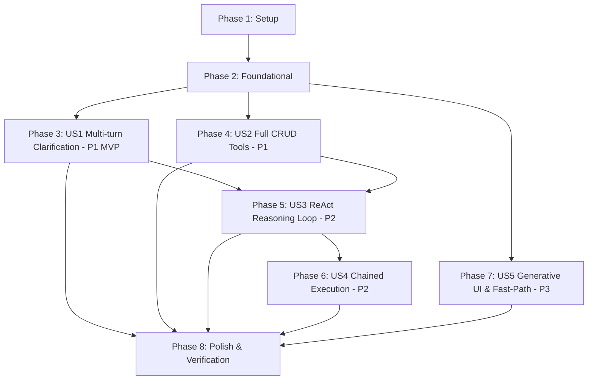

# Tasks: ReAct AI Agent Architecture with Full CRUD & Multi-turn Clarification

**Branch**: `022-react-agent-full-crud` | **Spec**: [spec.md](spec.md) | **Plan**: [plan.md](plan.md)

---

## Phase 1: Setup (Shared Infrastructure)

**Purpose**: Project initialization and basic structure for the ReAct engine

- [x] T001 Create `apps/mobile/lib/agent/engine/` directory for ReAct orchestrator and event streams
- [x] T002 [P] Create and verify test harness directory in `apps/mobile/test/unit/agent/`

---

## Phase 2: Foundational (Blocking Prerequisites)

**Purpose**: Core infrastructure and data models that MUST be complete before ANY user story can be implemented

**⚠️ CRITICAL**: No user story work can begin until this phase is complete

- [x] T003 [P] Define `AgentEvent` hierarchy (`RoundStarted`, `ModelCall`, `ToolExecution`, `FinalAnswer`, `AgentError`) in `apps/mobile/lib/agent/engine/agent_event.dart`
- [x] T004 [P] Define `PendingIntent` and `PendingIntentState` data models in `apps/mobile/lib/agent/memory/pending_intent_state.dart`
- [x] T005 [P] Implement `OpenAiToolSpecs` converting tool definitions to OpenAI JSON schemas in `apps/mobile/lib/agent/brain/tool_specs.dart`
- [x] T006 [P] Enhance `AgentMemoryContext` in `apps/mobile/lib/agent/memory/agent_memory_context.dart` to support role `'tool'`, `toolCallId`, and bounded sliding history preservation
- [x] T007 [P] Refactor `SystemPromptBuilder` in `apps/mobile/lib/agent/brain/system_prompt_builder.dart` to produce 3-Tier Prefix-Cached Prompts (`StaticPart` > 1024 tokens, `DynamicPart`, `UncachedPart`)

**Checkpoint**: Foundation ready - user story implementation can now begin in parallel

---

## Phase 3: User Story 1 - Multi-turn Clarification & Ambiguity Prevention (Priority: P1) 🎯 MVP

**Goal**: Halt execution and ask clarifying questions on ambiguous user inputs without hallucinating placeholder defaults, storing partial slots in `PendingIntentState` and completing the action when clarified.

**Independent Test**: Say "Cho bạn mượn 200k" $\to$ Verify Agent does NOT create any loan and responds "Bạn cho ai mượn 200k vậy?" $\to$ Reply "Thằng Nam" $\to$ Verify Agent creates a loan contact for "Nam" with 200.000 VND and deducts the amount from the default wallet.

### Tests for User Story 1
- [x] T008 [P] [US1] Unit tests for ambiguity detection and slot-filling in `apps/mobile/test/unit/agent/pending_intent_test.dart`

### Implementation for User Story 1
- [x] T009 [US1] Implement ambiguity prevention rules & prompt instructions in `apps/mobile/lib/agent/brain/system_prompt_builder.dart`
- [x] T010 [US1] Implement slot-filling extraction and pending intent resolution in `apps/mobile/lib/agent/memory/pending_intent_state.dart`
- [x] T011 [US1] Integrate `PendingIntent` lifecycle (ask clarification, store partial slots, merge responses) inside `AiAssistantNotifier` in `apps/mobile/lib/providers/ai_assistant_provider.dart`

**Checkpoint**: At this point, User Story 1 (Clarification & Slot-filling) is fully functional and testable independently.

---

## Phase 4: User Story 2 - Full CRUD & Update Operations Across All 7 Entities (Priority: P1)

**Goal**: Provide complete Create, Read, Update, and Delete tool coverage across all 7 domain entities (Transactions, Wallets, Categories, Budgets, Loans/Debts, Goals, Recurring).

**Independent Test**: Execute natural language update/delete commands for Wallets, Budgets, Loans, Goals, and Recurring rules, verifying database state updates accurately.

### Tests for User Story 2
- [x] T012 [P] [US2] Unit tests for new and updated CRUD tools in `apps/mobile/test/unit/agent/full_crud_tools_test.dart`

### Implementation for User Story 2
- [x] T013 [P] [US2] Implement `wallet_update` and `wallet_delete` tools in `apps/mobile/lib/agent/tools/write/wallet_tools.dart`
- [x] T014 [P] [US2] Implement `loan_update` and `loan_delete` tools with dual sync in `apps/mobile/lib/agent/tools/write/loan_tools.dart`
- [x] T015 [P] [US2] Implement `goal_update` and `goal_delete` tools in `apps/mobile/lib/agent/tools/write/goal_tools.dart`
- [x] T016 [P] [US2] Implement `recurring_update` and `recurring_delete` tools in `apps/mobile/lib/agent/tools/write/recurring_tools.dart`
- [x] T017 [P] [US2] Implement `budget_delete` tool in `apps/mobile/lib/agent/tools/write/budget_tools.dart`
- [x] T018 [US2] Register all new CRUD tools in `ToolRegistry` in `apps/mobile/lib/agent/tools/tool_registry.dart` and `tool_specs.dart`

**Checkpoint**: At this point, User Stories 1 AND 2 are fully functional and testable.

---

## Phase 5: User Story 3 - ReAct Reasoning Loop with Tool Feedback & Pre-condition Validation (Priority: P2)

**Goal**: Implement event-driven ReAct reason-act-observe cycle with safe error observation feedback for overdrafts, limit violations, and self-correcting explanations.

**Independent Test**: Have a Cash wallet with 300.000 VND $\to$ Say "Chuyển 1 củ từ Tiền mặt sang MoMo" $\to$ Verify the agent detects insufficient funds and responds with a friendly explanation of the 300.000 VND balance.

### Tests for User Story 3
- [x] T019 [P] [US3] Unit tests for ReAct reason-act-observe loop and error feedback in `apps/mobile/test/unit/agent/react_agent_test.dart`

### Implementation for User Story 3
- [x] T020 [US3] Implement `ReActAgent` engine with multi-round execution (`maxRounds = 4`) and safe error observation capture in `apps/mobile/lib/agent/engine/react_agent.dart`
- [x] T021 [US3] Implement financial pre-condition checks (insufficient balance, debt over-repayment) with diagnostic observation feedback in `apps/mobile/lib/agent/tools/write/`
- [x] T022 [US3] Integrate `ReActAgent` stream with `AiAssistantNotifier` in `apps/mobile/lib/providers/ai_assistant_provider.dart`

**Checkpoint**: ReAct loop with observation feedback is fully operational.

---

## Phase 6: User Story 4 - Multi-Action Batching & Chained Execution (Priority: P2)

**Goal**: Execute compound user requests with sequential dependencies (e.g., create category $\to$ record transaction) across multi-round ReAct iterations.

**Independent Test**: Say "Tạo danh mục Nuôi mèo màu cam rồi ghi khoản mua hạt mèo 250k vào đó" $\to$ Verify category is created in Round 1 and transaction is linked to newly created category in Round 2.

### Tests for User Story 4
- [x] T023 [P] [US4] Integration test for chained actions (create category $\to$ record transaction) in `apps/mobile/test/unit/agent/chained_actions_test.dart`

### Implementation for User Story 4
- [x] T024 [US4] Update `ReActAgent` to support sequential round progression for dependent tool outputs in `apps/mobile/lib/agent/engine/react_agent.dart`
- [x] T025 [US4] Update `FinancialSnapshotBuilder` in `apps/mobile/lib/agent/memory/financial_snapshot_builder.dart` to refresh dynamic snapshot state between ReAct rounds

**Checkpoint**: Compound dependent tasks execute seamlessly across ReAct rounds.

---

## Phase 7: User Story 5 - Instant Generative UI & Fast-Path Navigation (Priority: P3)

**Goal**: Immediate rendering of visual query cards and fast-path screen navigation commands.

**Independent Test**: Ask "Hôm nay tao tiêu những gì?" $\to$ Verify instant generation of Transaction List Card without state mutation.

### Tests for User Story 5
- [x] T026 [P] [US5] Unit test for fast-path query and navigation tool dispatch in `apps/mobile/test/unit/agent/fast_path_test.dart`

### Implementation for User Story 5
- [x] T027 [US5] Ensure read query tools (`query_transactions`, `view_wallets`, `view_debts`, `view_goals`, `view_budgets`) attach `AiViewPayload` in `apps/mobile/lib/agent/tools/read/`
- [x] T028 [US5] Verify screen navigation dispatch and direct callback trigger in `apps/mobile/lib/agent/tools/navigation/navigate_screen_tool.dart`

**Checkpoint**: Visual cards and screen navigation respond with sub-second latency.

---

## Phase 8: Polish & Cross-Cutting Concerns

**Purpose**: Quality assurance, static analysis, performance verification, and documentation synchronization

- [x] T029 [P] Validate prefix prompt token count (>1024 tokens) and format in `apps/mobile/test/unit/agent/system_prompt_builder_test.dart`
- [x] T030 Run Flutter analyzer `flutter analyze lib/agent/` and resolve any lints
- [x] T031 Run full agent unit test suite `flutter test test/unit/agent/` to verify 100% pass rate
- [x] T032 [P] Synchronize execution scenario documentation in `docs/03_core_features/agent_execution_scenarios.md`
- [x] T033 Run `specs/022-react-agent-full-crud/quickstart.md` verification checklist

---

## Dependencies & Execution Order

### Phase Dependencies

### User Story Dependencies
- **Foundational (Phase 2)** blocks all stories.
- **US1 (Clarification/Slot-Filling)** and **US2 (Full CRUD Tools)** can be developed in parallel once Phase 2 is complete.
- **US3 (ReAct Engine)** integrates US1 and US2 into the multi-round execution loop.
- **US4 (Chained Actions)** builds on the ReAct engine from US3.
- **US5 (Fast-Path UI/Navigation)** can proceed independently after Phase 2.

---

## Parallel Execution Opportunities

- **Phase 2 Foundational**: T003, T004, T005, T006, T007 can all be developed in parallel (separate files).
- **Phase 4 Full CRUD Tools**: T013 (`wallet_tools.dart`), T014 (`loan_tools.dart`), T015 (`goal_tools.dart`), T016 (`recurring_tools.dart`), T017 (`budget_tools.dart`) can all be implemented in parallel.
- **Tests**: All test files marked with `[P]` (T008, T012, T019, T023, T026, T029) can be authored in parallel before their respective implementations.

---

## Implementation Strategy

### MVP First (Phases 1, 2, 3)
1. Complete Setup & Foundational prerequisites (`AgentEvent`, `PendingIntentState`, `OpenAiToolSpecs`, `3-Tier Prompt`).
2. Implement **User Story 1** (Multi-turn clarification & slot-filling) to eliminate hallucinations immediately.
3. Validate US1 with unit tests.

### Incremental Delivery (Phases 4 through 8)
1. Implement **User Story 2** (All remaining Update/Delete CRUD tools).
2. Implement **User Story 3** (`ReActAgent` orchestrator & observation feedback).
3. Implement **User Story 4** (Chained execution & snapshot refresh).
4. Implement **User Story 5** (Fast-path read queries & generative UI cards).
5. Run full test suite and analyzer verification.
